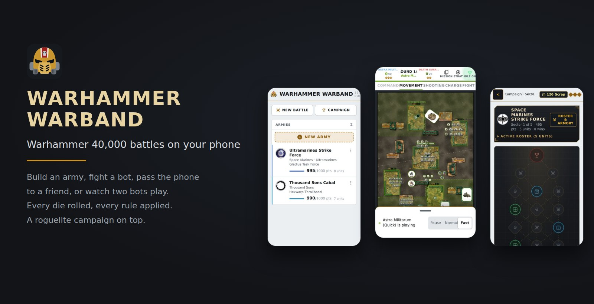
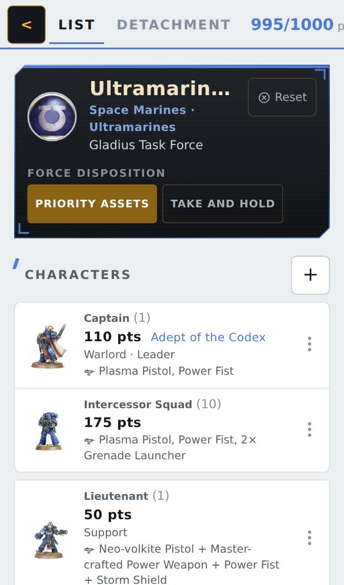
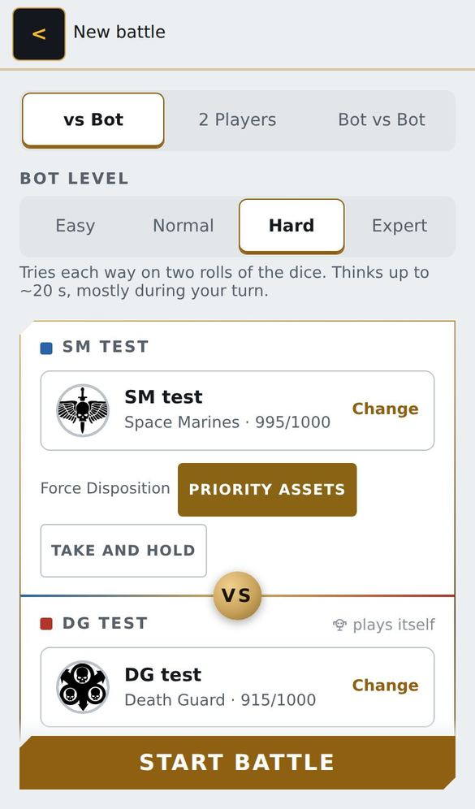
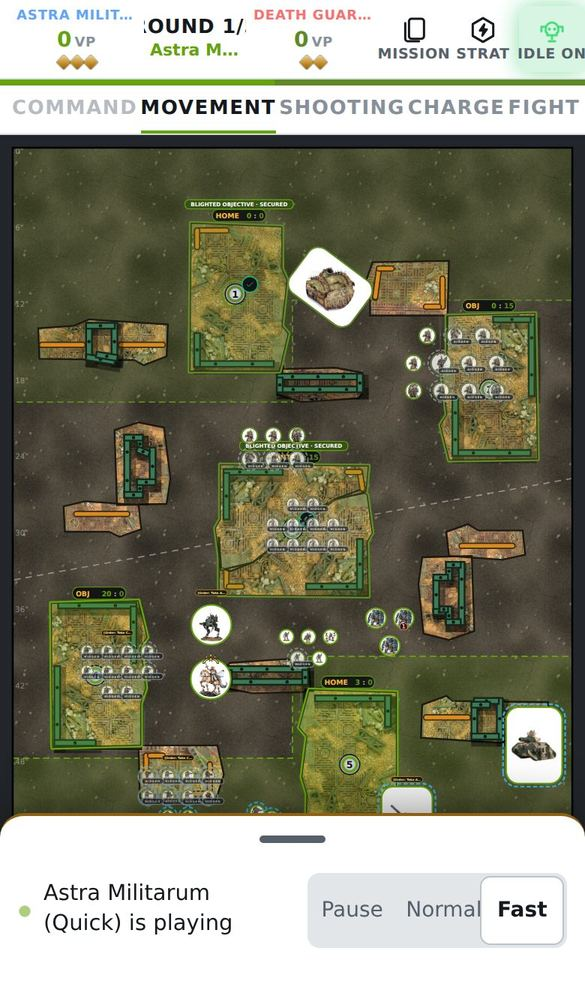
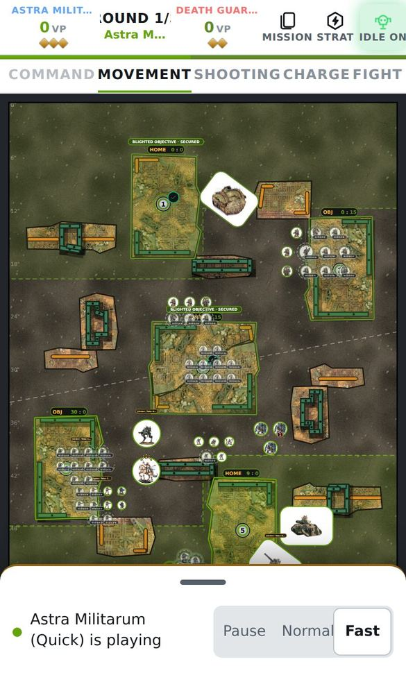

# Warhammer Warband

> **Production-Grade Competitive Warhammer 40,000 Tournament Simulator & AI Sparring Partner**



**Play directly in your browser: [solicwe.github.io/Warhammer-Warband](https://solicwe.github.io/Warhammer-Warband/)**  
*Zero install. Zero account required. Optimized for mobile touch devices and desktop browsers.*

---

## Overview

**Warhammer Warband** is an open-source, tournament-grade digital tabletop simulator and AI sparring companion for **Warhammer 40,000 (10th / 11th Edition)**. Engineered for competitive players, tournament organizers, and list builders, it models the official rules with mathematical precision, instant dice resolution, model-to-model geometric line of sight (LOS), and a sophisticated Grandmaster AI capable of piloting all 23 factions according to their distinct tournament archetypes.

Everything runs entirely client-side in the browser via deterministic state machines, ensuring lightning-fast execution, zero server latency, offline accessibility, and complete privacy.

---

## Screenshots

| Home & Army Builder | Battle Setup & Matchups | Tournament Battlefield | Tactical Combat Resolution |
| :---: | :---: | :---: | :---: |
|  |  |  |  |
| *Munitorum points & list validation* | *Incursion & Strike Force presets* | *45 official tournament layouts* | *Real-time Mathhammer EV resolution* |

---

## Core Features

### 1. Pure Official 40k Tournament Rules (5-Phase Turn Loop)
- **Full Phase Automation:** Command (Battle-shock, CP gain), Movement (Normal, Advance, Fall Back, Deep Strike, Strategic Reserves), Shooting, Charge, and Fight phases executed strictly by the book.
- **Advanced Core Mechanics:** Deep Strike denial bubbles (9" exclusion zones), Rapid Ingress, Overwatch fire lanes, Heroic Interventions, Pile-in / Consolidation geometry, Unit Coherency enforcement, and Transport Embark/Disembark.
- **Rules Fidelity:** 100% faithful to the official Warhammer 40,000 Core Rules and Designer's Commentary with no homebrew stat buffs or non-standard modifications.

### 2. Line of Sight (LOS) & True Geometric Tabletop Engine
- **Model-to-Model Raycasting:** Accurate line-of-sight verification calculated from model base perimeters with spatial partition caching.
- **Tournament Ruins & Cover Footprints:** Full support for standard tournament baseplates. Walls block true LOS; dense terrain footprints provide obscuring benefits; models wholly within ruin footprints gain the Benefit of Cover.
- **Physical Collision & Auto-Fit:** Bases cannot overlap models or impassable walls. Automated base-contact snapping for charges and legal pile-in positioning.

### 3. Tournament Army List Builder (1,000 & 2,000 Points)
- **Standard Battle Formations:** Native support for Incursion (1,000 pts) and Strike Force (2,000 pts) tournament formats.
- **Official Munitorum Field Manual Points:** Built-in datasheet library covering all 23 factions. Automatic validation of Leader attachments, Enhancement limits (max 3 per army, 1 per character, no Epic Heroes), Rule of Three (Rule of Six for Battleline and Dedicated Transports), and wargear options.
- **Instant List Sharing:** Export and import competitive army rosters in JSON and standard tournament text formats.

### 4. Primary & Tactical Secondary Missions
- **45 Tournament Layouts:** Complete library of competitive tournament table arrangements and terrain layouts.
- **Mission Packs:** Matched Play primary objectives (Take and Hold, Purge the Foe, Scorched Earth, Priority Targets, Linchpin, etc.) with real-time scoring.
- **Tactical & Fixed Secondaries:** Automated draw/discard deck for Tactical Secondary Missions (Assassination, Bring It Down, Cleanse, Storm Hostile Objective, Behind Enemy Lines, Engage on All Fronts, Sabotage, etc.) with CP generation for discarded cards.

### 5. Tournament-Grade Grandmaster Faction AI (23 Factions)
- **5 Tactical Faction Archetypes:**
  - `GUNLINE_CASTLE` (T'au Empire, Astra Militarum, Leagues of Votann, Adeptus Mechanicus, Imperial Knights): Defensive screening, maximum firing lane coverage, and calculated kiting.
  - `PRESSURE_MELEE_TRADING` (World Eaters, Orks, Chaos Daemons, Tyranids, Black Templars, Blood Angels): Stage-and-strike tactics behind obscuring ruins, threat range math, and multi-charge target overload.
  - `GLASS_CANNON_TRICKERY` (Aeldari, Drukhari, Genestealer Cults): Threat bubble evasion (`Move + 8"`), surgical trade-offs, and rapid objective stealing.
  - `ATTRITION_ANVIL` (Death Guard, Necrons, Adeptus Custodes, Grey Knights, Chaos Knights): Center-board control, durable toe-in objective contesting, and high-efficiency defensive positioning.
  - `COMBINED_ARMS_TACTICAL` (Space Marines, Chaos Space Marines, Thousand Sons, Adepta Sororitas): Adaptive transport blocking, CP preservation, and objective flipping.
- **Mathhammer Expected Value ($\text{EV}$) Allocation:** The AI computes expected wound profiles factoring Lethal Hits, Sustained Hits, Devastating Wounds, Twin-Linked, and Toughness/Save thresholds to eliminate overkill waste.
- **Deep Strike 9" Perimeter Screening:** Backline units are positioned in an 18" grid to deny enemy reserve drop zones.

### 6. Mobile-First UX/UI & 60 FPS Performance
- **Thumb-Zone Ergonomics:** All primary actions (Next Phase, Dice Tray, Selected Unit Datasheet, Stratagem Docks) are anchored to a collapsible Bottom Sheet and Action Bar.
- **Ultra-Compact Top HUD:** Minimalist 48px top header displaying Round, Phase, Score (VP), and CP counters, leaving $> 80\%$ of the screen dedicated to the board.
- **Touch-Friendly Controls:** Double-tap zoom, one-finger smooth pan, and **Ghost Preview + Confirm Move** (`[✓ Confirm Move]` / `[✕ Cancel]`) to prevent accidental finger-slip movements.
- **Performance Optimization:** DPR clamping ($\le 1.5$ on mobile), spatial bounding box LOS pre-checks, and async time-slicing ensure rock-solid 60 FPS gameplay on mobile devices.

### 7. Physical Tabletop Companion Mode
- Use your phone or tablet at the physical tabletop to score primary objectives, manage the tactical secondary mission deck, track CP, and view high-resolution 40k terrain layouts.

---

## Supported Factions

The engine includes complete datasheets, detachment rules, army rules, and stratagems for all 23 competitive factions:

| Imperium | Chaos | Xenos |
| :--- | :--- | :--- |
| • Adeptus Astartes (Space Marines) | • Chaos Space Marines | • Aeldari (Craftworlds) |
| • Blood Angels | • World Eaters | • Drukhari |
| • Dark Angels | • Death Guard | • Necrons |
| • Space Wolves | • Thousand Sons | • T'au Empire |
| • Black Templars | • Chaos Daemons | • Tyranids |
| • Adeptus Custodes | • Chaos Knights | • Genestealer Cults |
| • Grey Knights | | • Leagues of Votann |
| • Astra Militarum | | • Orks |
| • Adepta Sororitas | | |
| • Adeptus Mechanicus | | |
| • Imperial Knights | | |
| • Agents of the Imperium | | |

---

## Architecture & Tech Stack

```
warhammer-warband/
├── src/
│   ├── engine/           # Pure deterministic 40k game rules, math, LOS & state transitions
│   │   ├── attack.ts     # Attack sequence (Hit, Wound, Save, Damage, FNP, Devastating)
│   │   ├── game.ts       # Phase management, turn loop, scoring, and command triggers
│   │   ├── geometry.ts   # Base collisions, distance measurement, polygon clipping
│   │   ├── visibility.ts # Model-to-model LOS raycasting & cover calculations
│   │   └── types.ts      # Strictly typed GameState and Unit interfaces
│   ├── rules-engine/     # Detachments, Enhancements, and Stratagem execution
│   ├── factions/         # Official army rules (Blessings of Khorne, Orders, Pacts, etc.)
│   ├── ai/               # Competitive tournament AI decision engine
│   │   ├── factionArchetypes.ts  # Archetype-specific weights & behaviors
│   │   ├── tournamentTrainer.ts  # Headless self-play simulation & weight tuning
│   │   ├── botMove.ts    # Tactical positioning, screening, and objective anchoring
│   │   └── botPlan.ts    # Expected Value targeting and VP optimization
│   ├── ui/               # Mobile-first React 19 UI
│   │   ├── Board.tsx     # High-performance SVG tabletop renderer
│   │   ├── GameScreen.tsx# Main game orchestration, HUD & modal controllers
│   │   ├── ArmyBuilder.tsx# Tournament list validation and builder
│   │   └── TabletopScreen.tsx# Physical companion scorekeeper & deck manager
│   └── services/         # Replay compression, storage, and persistence
```

### Deterministic Seeded Replays
Every battle is driven by a seeded pseudo-random number generator (PRNG). Entire matches can be serialized, shared, and replayed tick-by-tick from past battle logs.

---

## Getting Started

### Prerequisites
- **Node.js**: v18.0.0 or higher
- **npm**: v9.0.0 or higher

### Installation & Development
```bash
# Clone the repository
git clone https://github.com/solicwe/Warhammer-Warband.git
cd Warhammer-Warband

# Install dependencies
npm install

# Start local development server
npm run dev
```
Open `http://localhost:5173` in your browser (or access the displayed local network IP from your phone).

### Running Tests
```bash
# Run unit tests and rules validation
npm test

# Run tests in watch mode
npm run test:watch
```

### Building for Production
```bash
# Compile and build production-ready bundle in dist/
npm run build
```

---

## Automated Self-Play AI Trainer

The built-in headless tournament trainer allows running thousands of automated AI vs AI matches in seconds to evaluate match-up balance, tune archetype heuristic weights, and verify rules consistency:

```bash
# Run headless tournament self-play benchmark
npx vitest run src/ai/tournamentTrainer.test.ts
```

---

## Legal Disclaimer

This is an unofficial, non-commercial fan project developed for competitive tabletop analysis, match simulation, and education. It is not affiliated with, endorsed, or sponsored by Games Workshop Limited. Warhammer 40,000, Citadel, Space Marine, and all associated logos, characters, and rules are registered trademarks of Games Workshop Limited.

---

## License

This project is licensed under the MIT License - see the [LICENSE](LICENSE) file for details.
