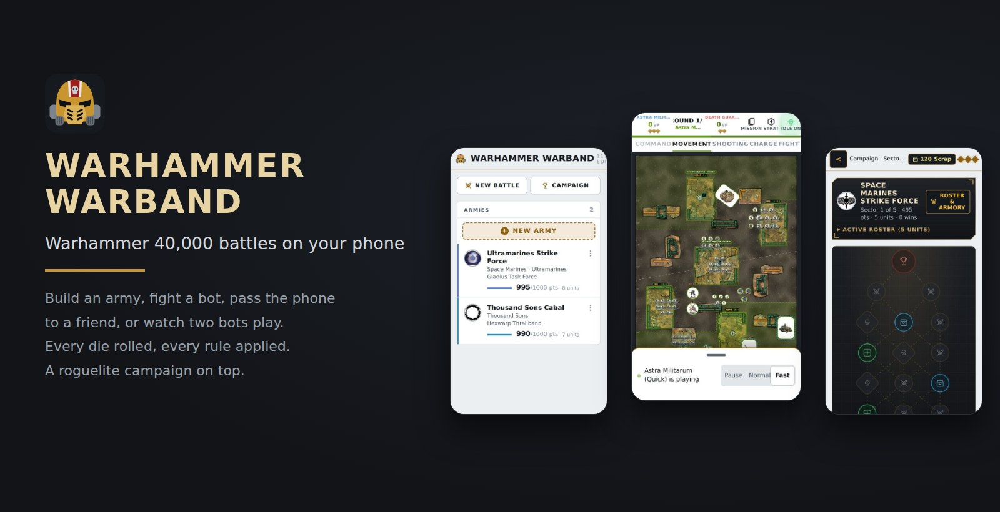
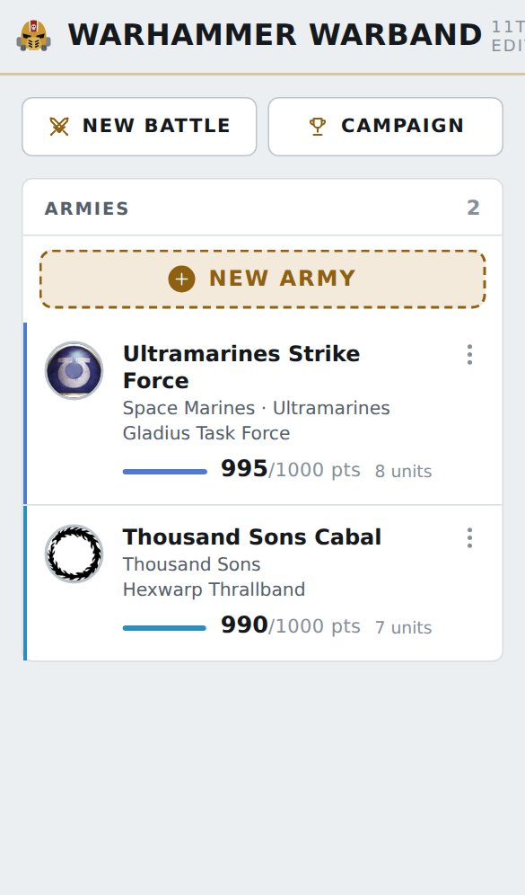
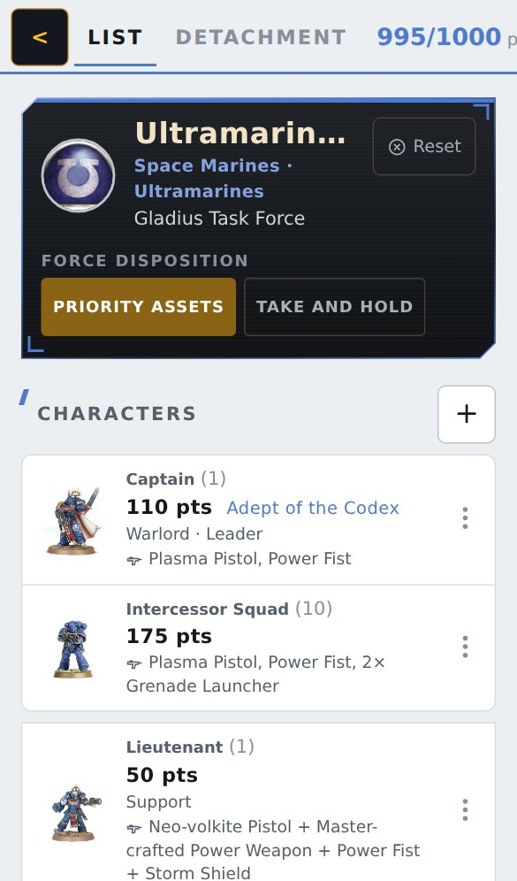
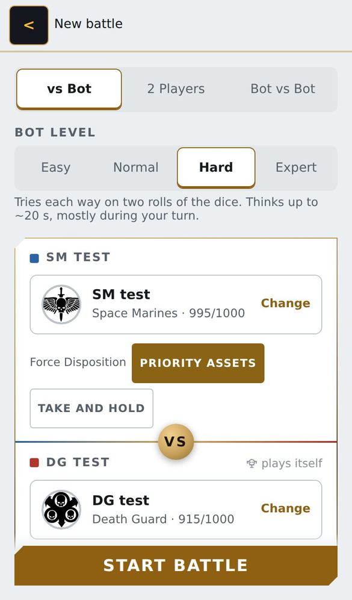
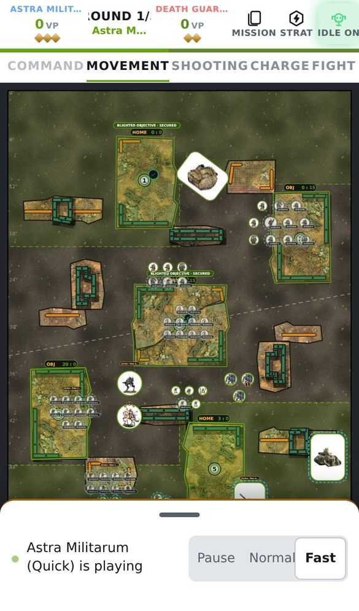
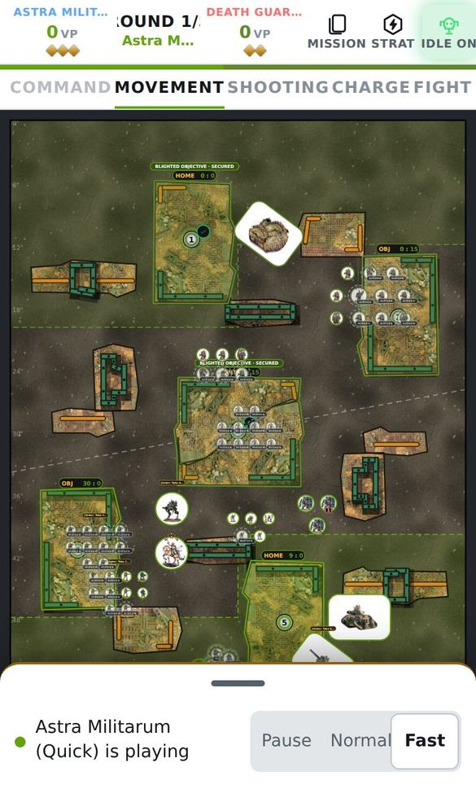
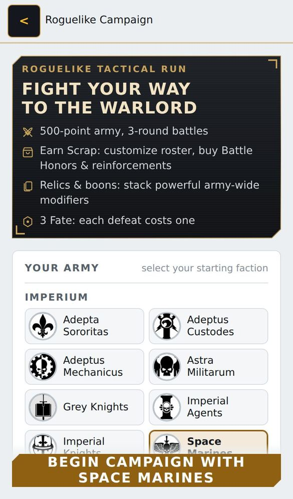
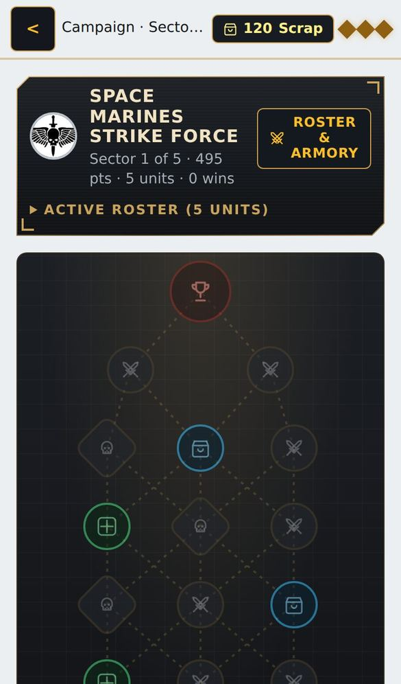

# Warhammer Warband



**Play it in your browser: [solicwe.github.io/Warhammer-Warband](https://solicwe.github.io/Warhammer-Warband/)**. No
install, no account. On a phone, add it to your home screen and it works like an app.

<table>
  <tr>
    <td align="center" width="25%"><br><sub><b>Home.</b> Your armies first; New battle and Campaign sit at the top.</sub></td>
    <td align="center" width="25%"><br><sub><b>Army builder.</b> Units, leaders, wargear and enhancements at current points. Epic Heroes sit with the Characters.</sub></td>
    <td align="center" width="25%"><br><sub><b>Battle setup.</b> Against the bot, two players, or bot against bot.</sub></td>
    <td align="center" width="25%"><br><sub><b>The battlefield.</b> Terrain, objectives and every model to scale.</sub></td>
  </tr>
  <tr>
    <td align="center"><br><sub><b>Attacks.</b> Every roll is made and shown on the board.</sub></td>
    <td align="center"><br><sub><b>Campaign.</b> Pick a faction and fight your way to the Warlord.</sub></td>
    <td align="center"><br><sub><b>Campaign map.</b> Battles, elites, armories, medicae and the boss.</sub></td>
    <td align="center" valign="middle"><sub>23 factions with their army rules, detachments, stratagems and unit abilities, all 45 mission layouts, and a bot that plays the same rules you do.</sub></td>
  </tr>
</table>

Warhammer Warband is a browser game for playing Warhammer 40,000 (11th edition) battles on your phone. You build an
army list, then fight a bot, pass the phone to a friend, or watch two bots play each other. There is also a campaign:
a run of battles across a branching map where your army grows an army tree and gains reinforcements.

Everything runs in the browser. There is no game server and no account. Your armies and battles are saved on your
device.

This is an unofficial fan project. It is not made, approved or endorsed by Games Workshop. Warhammer 40,000 and all
related names, rules text and imagery belong to Games Workshop.

## Playing

1. **Build an army.** On the home screen, tap New army, pick a faction, then add units, leaders, wargear and
   enhancements. Points follow the current Munitorum Field Manual and the builder warns you when a list breaks a rule.
2. **Start a battle.** New battle lets you choose the mode (against the bot, two players on one device, or bot
   against bot), each side's army, the mission and the map. Short three-round games are an option.
3. **Play your turns.** You move units and pick targets. The game handles the rest: it rolls every die, applies
   re-rolls and modifiers, and resolves abilities at the right moment. Each roll is shown with the number it needed
   and why.
4. **Or let the bot play for you.** The Idle button in the top bar hands your side to the bot, in a normal battle
   or in the campaign, and you watch. Tap it again to take back control.

The bot plays the same rules you do, including stratagems and faction abilities, and has several difficulty levels.

## How the battle works

The game follows the 11th edition core rules. A summary of what is modelled, with the official rule numbers, is in
[docs/01-rules-11e-reference.md](docs/01-rules-11e-reference.md).

- **Phases.** Each turn runs Command, Movement, Shooting, Charge and Fight, in that order. Command points, Battle-shock,
  reserves, Deep Strike, Advance, Fall Back, overwatch, heroic interventions, pile-in and consolidation are all in.
- **Terrain footprints.** Every piece of terrain sits on a baseplate, its footprint. Models walk into ruin footprints
  freely but can't walk through walls. Every model, vehicles included, may end a move inside one to hold an objective. Titanic models stand astride ruins.
- **Line of sight.** Sight is checked model to model. Walls block it. A dense footprint that neither model stands in
  blocks it completely. A model inside a footprint can see out and be seen.
- **Benefit of cover.** A unit has cover only when every one of its models qualifies: an infantry, beast or swarm
  model standing in a terrain area, or any model that terrain hides in part. A tank in the open never has cover; a tank
  partly behind a ruin does. Cover worsens the attacker's Ballistic Skill by 1.
- **Hidden.** Infantry, beasts and swarms in light or dense terrain that did not shoot this turn or last turn are
  hidden, and can only be seen by enemies within 15".
- **Objectives.** An objective on terrain covers the whole plate (or both plates, when the marker sits where two meet).
  The plate is tinted in the colour of the army that holds it.
- **Missions.** All 45 official layouts, every primary mission and the secondary deck (tactical or fixed) are
  scored automatically. Bigger games (3000 points and up) use a larger table.

### Factions and rules

Every faction with a ready-made army (23 of them, plus Titan Legions as allies) has its army rules, detachment
rules, enhancements, stratagems and unit abilities wired into the engine, and the bot uses them. [docs/RULES_STATUS.md](docs/RULES_STATUS.md) lists the status of every
rule, faction by faction. "Works" there means the rule runs. A spot check found most such rules exact, but some have
numbers or conditions that don't match the card yet, especially in factions whose data was generated by script. If you
find one, the fix is usually a one-line change in `data/` (see below).

Tap the info button next to any ability, stratagem or rule to read its full text.

### Building an army

The unit picker lists every datasheet of the faction at once. Tap + on a unit with more than one size and the
size list stays open, so you can add several in a row; tap + again (or + on another unit) to close it. Wargear Options covers weapon swaps, costed wargear,
optional extra models and, for units that list each loadout as its own model line (Deathwatch Veterans), how many
models take each loadout. Unit pictures and army emblems can't be changed in the app; new pictures are added to the
site's image folder (see "Add unit pictures" below).

On a unit's datasheet each model line shows its name, then M T Sv W Ld OC, with the invulnerable save shield under
Sv. The weapon table shows how many models carry each weapon (x8 Boltgun); weapons the unit could take but doesn't
are dimmed.

### Reading the rules

The Detachment tab shows the detachment rule, enhancements and stratagems coloured by the phase they are used in
(Command amber, Movement green, Shooting orange, Charge purple, Fight red). Each stratagem is laid out as WHEN /
TARGET / EFFECT, with its CP cost, whose turn it is and its type, and the list can be filtered by phase. Enhancements
show who can take them and the phase they matter in. Rules with named options (Mission Tactics, Rituals with their
Warp Charge) show each option in its own block, and bullet lists read as lists. With two or more detachments each
one gets its own heading.

## Campaign

The campaign is a roguelite run with one faction. You start with a small army and travel across a branching map of
battles, elite fights (enemies with a special rule), supply drops, armories, medicae tents and a boss at the end.

- **Scrap** is the currency. You earn it by winning (and 25 a round in battle, +20 and +1 CP while you hold the
  centre objective) and spend it in the armory on recruits, wargear, enhancements and detachments. A detachment costs
  60, 110 or 170 Scrap for 1, 2 or 3 Detachment Points.
- **Missions.** Each battle plays one of the official primary missions (many are won with actions), shown on the
  map before you fight.
- **The enemy grows with you.** Enemies bring more detachments as you win (one more every 3 wins and every sector,
  one more for an elite or boss, up to 4), and an army tree with as many nodes as yours (+3 elite, +6 boss).
- **Reinforcements** are offered after battles, each with a rarity (common, rare, epic, legendary) that follows how
  big the unit is.
- **Army tree.** One passive tree for the whole army, paid for with Renown (battle 3, elite 5, boss 6, a loss 1).
  Seven shared spokes (Fire, Assault, Armour, Speed, Command, Objectives, Logistics) and three branches of your army's
  own (its army branch, a corps and an arsenal, on its real keywords: Terminators and Gravis for Space Marines, Wych
  Cults and Kabals for Drukhari, Hernkyn and Ironkin for the Votann...) sit around a start node, with an inner ring of
  bridges halfway out. Each shared spoke has three side clusters and, past its tip, a keystone that makes one keyword
  count as another; spoke ends are not joined, so a spoke's far nodes are reached only by walking that spoke (about
  210 nodes in all, many of them buffs for the whole army). Every node fits the army: a node for a keyword the army
  cannot field (MONSTER for Space Marines, VEHICLE for Tyranids, INFANTRY for Knights) is swapped for an army-wide one.
  Nodes reach units by keyword, some only in rounds 1-2 or from round 3, and some add a bonus once
  enough nodes of their spoke are taken. Refund a node for Scrap at an armory or medicae tent. An army that can field
  titanic units or allied Knights unlocks them with the keystone at the end of its arsenal branch (Questor Oath,
  Gargant Mob, Monolith Phalanx...); Drukhari, Genestealer Cults and the Votann have none and get another keystone
  there, and Imperial and Chaos Knight armies need none for their own Knights. Details in [docs/04-campaign-tree.md](docs/04-campaign-tree.md).
- **Relics** are artefacts with special rules the tree never gives: invulnerable saves, -1 Damage, Critical Hits on
  5+, mortal wounds, Fights First, [LANCE], [DEVASTATING WOUNDS], shooting or charging after Advancing... A relic you
  already hold comes back as an upgrade while a level still improves it, and its text is written from what it does.
- **VETERAN.** A unit that has fought 3 battles becomes VETERAN by itself, and tree nodes that name VETERAN reach it.
- **Battles are won on points.** Both sides play the battle's primary mission (and its actions); nothing ends a
  battle early, not even wiping out the enemy, and boss and elite battles are decided on VP like the others.
- **Kills still count a little.** Destroying an enemy unit gives 1 VP (2 for a character, vehicle or monster), up to
  12 VP a battle, well under the 45 the primary mission can give.

## On your phone

- The battlefield fills the screen. Tap a unit on the map to act with it. The bottom sheet lists only what isn't on
  the table (reserves and embarked units) and can be folded down to its handle.
- When a sheet, the dice or a menu covers most of the screen, a small live map window appears under the phase tabs.
  It follows the action (the attack under way, the unit you picked, or the last unit that acted) and shows a line
  about what just happened. Drag the picture to look around, pinch it to zoom, drag its caption to move it, or close it.
- Pinch to zoom and drag to pan. The view stays on the table.
- **Moving and setting up.** Drag a model or use the stick, then press Confirm. Cancel, Reset and Confirm sit at the
  top of the sheet, above the stick, so they stay on screen. Bikes and vehicles get turn buttons (45 degrees a press)
  while they move or set up, and keep the facing you gave them. A facing within 20 degrees of straight snaps straight.
- **Auto fit.** A unit set down against a wall or another model shuffles to the nearest legal spot, and a long base
  also turns to find an angle that fits. Pile-in and consolidation are automatic: each model tries every spot around
  the nearest enemy models, base contact first, while the unit stays in coherency.
- The site can be added to your home screen and works like an app.

## Saves

- **On this device.** Armies, the battle in progress, the campaign and your settings are saved in the browser as you
  play. Closing the tab or the browser loses nothing.

Nothing leaves your device, and the site sends a Content Security Policy that only allows its own files and Google Fonts.

## Running it yourself

You need Node.js (the version is in `.nvmrc`).

```bash
npm install
npm run dev        # http://localhost:5173, also reachable from a phone on the same network
npm test           # rules engine tests and full bot-against-bot games
npm run build      # static site in dist/
```

### Deploying to GitHub Pages

The workflow in `.github/workflows/deploy.yml` builds `main` and publishes it to GitHub Pages on every push.

1. In the repository settings, open Pages and set the source to GitHub Actions. Pages on a private repository
   needs a paid GitHub plan; on a public repository it is free.
All paths in the app are relative, so it works at `https://<user>.github.io/<repository>/`. The workflow also
publishes a copy of the page as `404.html`, so a refresh never lands on an error page.

## For developers

- [ARCHITECTURE.md](ARCHITECTURE.md) explains the layers (`engine`, `rules-engine`, `factions`, `ai`, `ui`,
  `services`), the turn loop and the hooks that let faction rules plug in without touching the core.
- [AI_GUIDE.md](AI_GUIDE.md) is the checklist for common changes: fixing an ability, adding a stratagem, adding a
  faction, changing the bot.
- [docs/EDITING.md](docs/EDITING.md) maps every kind of rule to the data file it lives in.

Common changes in short:

- **Fix or add a rule.** Most rules are data. Edit `data/abilities/<FACTION>.json`, `data/stratagems/<FACTION>.json`
  or `data/detachment-rules.json`, then run `npx vitest run src/engine/rulesData.test.ts`.
- **Correct a datasheet.** Put the change in `data/overrides/<FACTION>.json`. Don't edit
  `public/data/factions/*.json`, which is regenerated from the source data by `npm run data`.
- **Add a faction.** Generate its data with `npm run data`, add its rule data files, and if it has a rule that keeps
  its own state, write a module in `src/factions/` and register it in `src/factions/index.ts`.
- **Add unit pictures.** Drop images in `public/images/units/<FACTION>/` named after the datasheet (for example
  `intercessor-squad.webp`) and run `npm run images` to rebuild the manifest.
- **Add a game mode.** Modes are set up in `src/ui/BattleSetup.tsx` and run on the same `GameState`. Pass options
  through `createGame` in `src/engine/game.ts`.
- **Change the look.** Keep to WCAG 2.2 AA: text at 4.5:1 contrast or more (take colours from the tokens at the top
  of `src/ui/styles.css`, and mix a faction colour toward `--text` before using it as text), touch targets of 44 px
  where there is room and never under 24 px, no text under 11 px, and leave page zoom on in `index.html`.

The engine is deterministic: every die comes from a seeded generator, so any game can be replayed from its seed.
Never use `Math.random()` in `src/engine/`.
