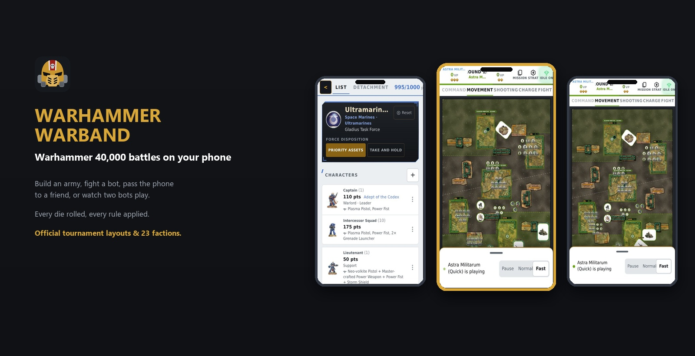
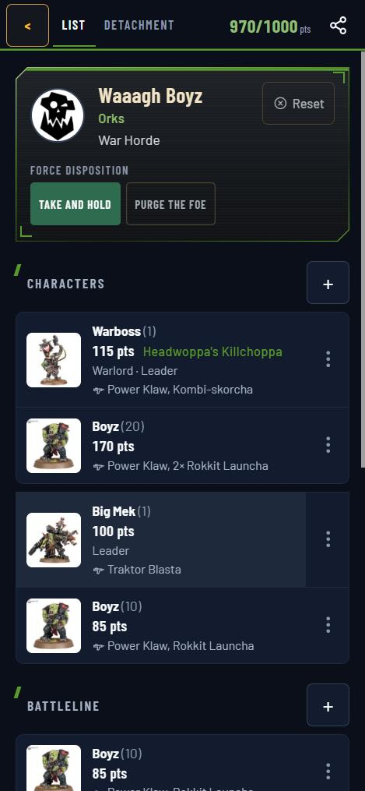
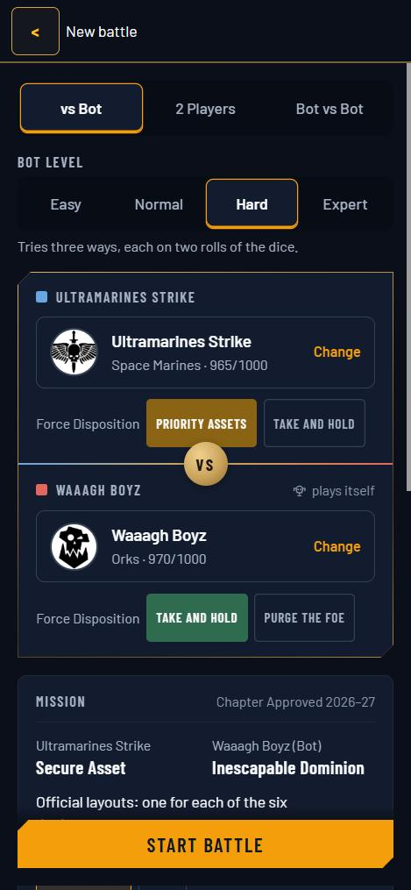
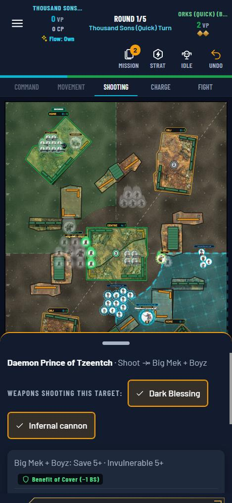
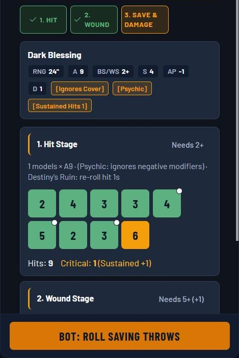

# Warhammer Warband

A Warhammer 40,000 (11th edition) battle game for the phone browser: build an army, play a full game against a bot or
a friend on one device, or use it as a companion at a real table.



**Play: [solicwe.github.io/Warhammer-Warband](https://solicwe.github.io/Warhammer-Warband/)**. No install, no account.
Made for a phone held upright; it works on a desktop too. Everything runs in the browser; nothing is sent to a server.

## Screenshots

| Army builder | New battle | Battle | Dice |
| :---: | :---: | :---: | :---: |
|  |  |  |  |

## What it does

**Army builder.** The datasheets, points, detachments, enhancements and stratagems of 23 factions, read from the
11th edition faction data. It checks Leaders, enhancements, unit limits and wargear, and lists units that may join
as allies (Freeblades, Titanic Support, Assigned Agents for Imperium armies; Chaos Knights for Chaos armies).
Battle sizes: Incursion (1,000), Strike Force (2,000), Onslaught (3,000), War Zone (4,000) and Apocalypse (5,000),
all on the 44" x 60" table.

**A full game.** The five phases with the rules that matter on the table: moves, Advance and Fall Back, Deep Strike
and Strategic Reserves, transports (embark, the three ways to disembark, Firing Deck), shooting with line of sight
and cover, charges, Pile-in and Consolidation, and the attack sequence (hit, wound, save, damage, Feel No Pain,
Precision, the weapon abilities). Stratagems that react to the opponent (after an enemy unit has selected its
targets, after it moved, Fire Overwatch, Heroic Intervention) stop the game and ask the player. A player spends their
own Command points: every Command Re-roll is a button, nothing is re-rolled for a person without asking.

**Missions.** The 45 official layouts of the 2026-27 mission deck (six deployments), the primary missions of each
pairing of Force Dispositions, and fixed or tactical secondary missions with their scoring. A small empty
24" x 30" Test range (not an official layout) for trying out weapons.

**The bot.** It plays every faction: it plans moves towards objectives and cover, picks targets by expected damage,
uses stratagems and its army's rules, and rides in transports (a squad with strong guns fires from a Firing Deck).
Big games stay smooth: it thinks in a background worker.

**Tabletop companion.** At a real table: the mission and layout of your pairing with measurements, the score, the
secondary deck and the Command points.

Which rules run, faction by faction: [docs/RULES_STATUS.md](docs/RULES_STATUS.md). Known gaps:
[docs/05-tech-debt.md](docs/05-tech-debt.md).

## Factions

| Imperium | Chaos | Xenos |
| :--- | :--- | :--- |
| Space Marines (with Blood Angels, Dark Angels, Space Wolves, Black Templars) | Chaos Space Marines | Aeldari |
| Adeptus Custodes | World Eaters | Drukhari |
| Grey Knights | Death Guard | Necrons |
| Astra Militarum | Thousand Sons | T'au Empire |
| Adepta Sororitas | Emperor's Children | Tyranids |
| Adeptus Mechanicus | Chaos Daemons | Genestealer Cults |
| Imperial Knights | Chaos Knights | Leagues of Votann |
| Agents of the Imperium | | Orks |

## For developers

React 19, TypeScript and Vite; tests in Vitest. Node 22 (`.nvmrc`).

```bash
npm install
npm run dev        # http://localhost:5173, or the network address shown, from a phone
npm test           # the everyday suite
npm run test:slow  # whole bot-vs-bot games and the simulations (minutes)
npm run build      # dist/
npm run data       # rebuild public/data from data/raw and data/overrides
```

Where things are: [ARCHITECTURE.md](ARCHITECTURE.md) (layers and hooks), [AI_GUIDE.md](AI_GUIDE.md) (step lists for
common changes), [docs/EDITING.md](docs/EDITING.md) (which data file holds which rule). The engine is deterministic: a
game is driven by a seeded random number generator. The site deploys from `main` only after the CI run (build and
tests) passes.

Bot strength: `node scripts/elo.mjs --games 48` plays the live bot against the frozen baseline and records an Elo in
`data/bot-elo.json`.

## Feedback

[Suggestions](https://github.com/solicwe/Warhammer-Warband/issues/new?template=feedback.yml) ·
[Bug or rules error](https://github.com/solicwe/Warhammer-Warband/issues/new?template=bug_report.yml) ·
[All issues](https://github.com/solicwe/Warhammer-Warband/issues)

## Legal

An unofficial, non-commercial fan project, not affiliated with or endorsed by Games Workshop Limited. Warhammer
40,000 and all associated names are trademarks of Games Workshop Limited. MIT License, see [LICENSE](LICENSE).
