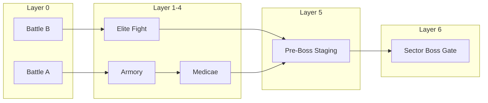
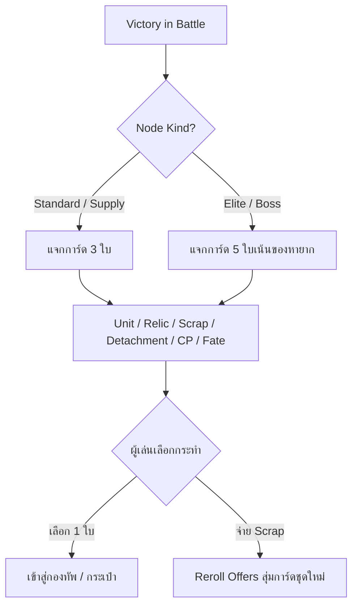
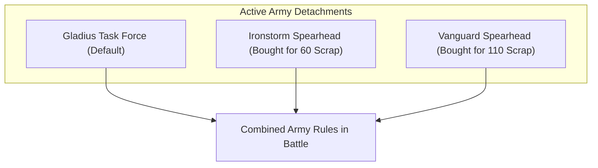
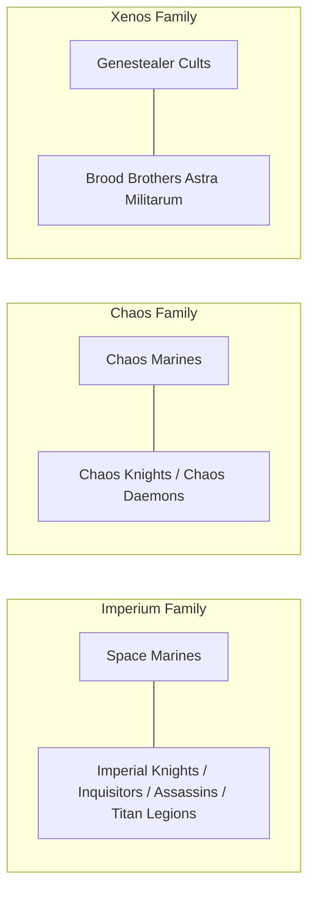
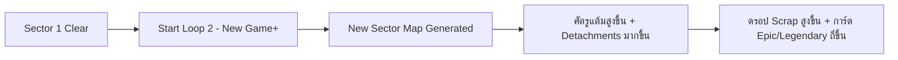

# Warhammer Warband: Complete Campaign Systems Architecture (Existing Features Specification)

เอกสารรวบรวมและวิเคราะห์โครงสร้างระบบ **Campaign Mode ทั้งหมดที่มีอยู่ในเกม ณ ปัจจุบัน (นอกเหนือจาก 5 เสาหลัก ARPG Engine: Tree, Tokens, Relics, Anomalies, Ascendancy)** เพื่อนำไปใช้เป็นฐานข้อมูลในการออกแบบฟีเจอร์ใหม่ ระบบเนื้อเรื่อง เควสต์ หรือเอนจินเกมเพลย์ส่วนขยายเพิ่มเติม

---

## สารบัญระบบแคมเปญ (Campaign Systems Index)

1. [โครงสร้างแผนที่และการเดินทาง (Sector Map & Navigation Engine)](#1-โครงสร้างแผนที่และการเดินทาง-sector-map--navigation-engine)
2. [ระบบเศรษฐกิจและทรัพยากร (Currencies & Economy)](#2-ระบบเศรษฐกิจและทรัพยากร-currencies--economy)
3. [ระบบการ์ดรางวัลหลังจบการรบ (Post-Battle Reward Cards & Drafting)](#3-ระบบการ์ดรางวัลหลังจบการรบ-post-battle-reward-cards--drafting)
4. [ระบบจัดการกองกำลังและยูนิต (Roster & Unit Management)](#4-ระบบจัดการกองกำลังและยูนิต-roster--unit-management)
5. [ระบบกองร้อยผ่านศึก (Veteran Progression System)](#5-ระบบกองร้อยผ่านศึก-veteran-progression-system)
6. [ระบบ Detachments ผสมผสาน (Multi-Detachment Synergy)](#6-ระบบ-detachments-ผสมผสาน-multi-detachment-synergy)
7. [ระบบ Enhancements หลายช่องบนตัวละคร (Multi-Slot Enhancements)](#7-ระบบ-enhancements-หลายช่องบนตัวละคร-multi-slot-enhancements)
8. [ระบบกองหนุนพันธมิตรและหุ่นรบยักษ์ (Allied Forces & Titan Requisitions)](#8-ระบบกองหนุนพันธมิตรและหุ่นรบยักษ์-allied-forces--titan-requisitions)
9. [ระบบโหนดสนับสนุนพิเศษ (Support Nodes: Armory & Medicae Tent)](#9-ระบบโหนดสนับสนุนพิเศษ-support-nodes-armory--medicae-tent)
10. [ระบบการปรับตัวและบอสของฝ่ายศัตรู (Enemy Scaling & Boss Rules)](#10-ระบบการปรับตัวและบอสของฝ่ายศัตรู-enemy-scaling--boss-rules)
11. [ระบบภารกิจและรูปแบบการจัดวาง (Mission Primaries & Dispositions)](#11-ระบบภารกิจและรูปแบบการจัดวาง-mission-primaries--dispositions)
12. [ระบบวงล้อความยากไม่รู้จบ (Loop / Sector Progression - New Game+)](#12-ระบบวงล้อความยากไม่รู้จบ-loop--sector-progression---new-game)
13. [ระบบต่อสู้อัตโนมัติและแทคติกไอเดิล (Idle / Tactical Bot Engine)](#13-ระบบต่อสู้อัตโนมัติและแทคติกไอเดิล-idle--tactical-bot-engine)
14. [ระบบบันทึกพงศาวดารสงคราม (Campaign Chronicle & Story Log)](#14-ระบบบันทึกพงศาวดารสงคราม-campaign-chronicle--story-log)

---

## 1. โครงสร้างแผนที่และการเดินทาง (Sector Map & Navigation Engine)

แผนที่ในแต่ละ Sector เป็นกราฟเส้นทางแบบหลายเลเยอร์ (Directed Node Graph) สร้างขึ้นด้วยระบบ Procedural Generation ตามค่า Seed:

### 1.1 ประเภทของโหนดบนแผนที่ (Map Node Kinds)
- **`battle` (สนามรบมาตรฐาน):** การปะทะทั่วไป ศัตรูมีขนาดกองทัพเท่ากับผู้เล่น ได้รับรางวัลเป็นการ์ด 3 ตัวเลือก (Unit, Relic, Scrap, Detachment)
- **`elite` (สนามรบชั้นสูง):** ศัตรูระดับหัวกะทิ ได้รับแต้ม Passive Tree เพิ่มเติม (+3 แต้ม) และได้รับ **Boss Rule พิเศษ 1 ข้อ** เมื่อชนะจะได้รับรางวัลการ์ดระดับสูง 5 ตัวเลือก
- **`boss` (ศึกตัดสินประจำ Sector - Layer 6):** บอสใหญ่ของ Sector ได้รับแต้ม Passive Tree เพิ่มเติม (+6 แต้ม), ได้รับ **Boss Rules 2 ข้อซ้อนกัน**, และศัตรูมี Detachments เพิ่มขึ้น ชนะแล้วจะปลดล็อกการขึ้นสู่ Loop ถัดไป
- **`armory` (คลังแสงสรรพาวุธ):** จุดพักทัพปลอดการสู้รบ สามารถรีสเปก/คืนแต้ม Tree, จัดซื้อยูนิต, ซื้อ Detachments และ Enhancements
- **`medicae` (เต็นท์พยาบาลสนาม):** จุดฟื้นฟูสภาพทัพ ซื้อแต้ม Fate Re-roll, อัปเกรดแต้ม CP ถาวร, และรักษาอาการบาดเจ็บ

### 1.2 กฎการเดินทางและสุ่มศัตรู
- ผู้เล่นเดินหน้าได้ทีละ Layer ตามเส้นเชื่อมโยง (`connections`) ไม่สามารถเดินถอยหลังได้
- ศัตรูในแต่ละโหนดจะสุ่มจาก 23 กองทัพหลัก (`ALL_PLAYABLE_FACTIONS`) โดยมีระบบ **Anti-Repetition Tracking (`recentOpponents`)** เพื่อป้องกันไม่ให้เจอเผ่าเดิมซ้ำใน 2-3 โหนดติดกัน

---

## 2. ระบบเศรษฐกิจและทรัพยากร (Currencies & Economy)

Campaign ใช้ระบบเศรษฐกิจ 4 สกุลที่แยกหน้าที่กันอย่างชัดเจน:

| สกุลเงิน (Currency) | แหล่งที่มา (Source) | วัตถุประสงค์การใช้งาน (Usage) |
|---|---|---|
| **Scrap** (เศษโลหะสงคราม) | - ชนะการรบ (ตามขนาดด่าน) - ขายยูนิตที่ไม่ได้ใช้ - การ์ดรางวัล Scrap (80–120 Scrap) | - เกณฑ์ยูนิตใหม่ (Recruit) - ซื้อ Detachments และ Enhancements - ปรับขนาดกองร้อย (Squad Scaling) - สุ่มการ์ดรางวัลใหม่ (Reroll Offers) - คืนแต้มสกิลใน Tree (Refund Nodes) |
| **Renown** (เกียรติยศ) | - ชนะการรบปกติ (+3) - ชนะ Elite (+5) - ชนะ Boss (+6) - แพ้การรบ (+1 ปลอบใจ) | - ใช้ 1 Renown ต่อการอัป 1 โหนดใน Passive Skill Tree (ไม่ใช้ Scrap ในการอัป) |
| **Command Points (CP)** | - โหนด Command ใน Tree - บริการ Rejuvenation ที่ Medicae Tent - การ์ดรางวัล CP ถาวร | - แต้ม CP ติดตัวตอนเริ่มเกมทุกด่าน นำไปใช้กด Stratagems และความสามารถพิเศษ |
| **Fate Points** (ชะตากรรม) | - เริ่มต้นรอบแคมเปญ - ซื้อที่ Medicae Tent - การ์ดรางวัล Fate | - ใช้ทอยลูกเต๋าใหม่ (Battle Rerolls) กลางสนามรบเมื่อเกิดจังหวะวิกฤต |

---

## 3. ระบบการ์ดรางวัลหลังจบการรบ (Post-Battle Reward Cards & Drafting)

เมื่อชนะในแต่ละโหนด หน้าจอจะสลับเข้าสู่กระบวนการ **Reward Drafting Phase**:

### 3.1 กลไกระดับความหายาก (Reward Rarity Scaling)
การ์ดยูนิตและรางวัลจะสุ่มระดับ Rarity (`common`, `rare`, `epic`, `legendary`) โดยโอกาสคำนวณจาก **ความลึกของแผนที่ (`depth = loop * 3 + path.length`)**:
- **ช่วงต้น (Depth < 4):** Common 45%, Rare 35%, Epic 15%, Legendary 5%
- **ช่วงกลาง (Depth 4–7):** Common 25%, Rare 37%, Epic 26%, Legendary 12%
- **ช่วงท้าย (Depth 8+):** Common 10%, Rare 25%, Epic 40%, Legendary 25%

### 3.2 โบนัสพิเศษ: Free Leader Attached บน Legendary Units
หากผู้เล่นสุ่มได้การ์ดยูนิตระดับ **Legendary** ตัวเกมมีระบบค้นหา Character Leader ของเผ่านั้นที่มีความสามารถแนบเข้ากับยูนิตดังกล่าวได้ (`canLeaderAttach`) และ **แถมแม่ทัพ Leader ประกบติดมาให้ฟรีในกองทันที!**

### 3.3 ระบบ Reroll ด้วย Scrap
หากไม่พอใจการ์ดรางวัล ผู้เล่นสามารถกด **[Reroll Rewards]** ได้โดยจ่าย Scrap ซึ่งราคาจะเพิ่มขึ้นทีละขั้นตามจำนวนครั้งที่เคยกดในรอบนั้น

---

## 4. ระบบจัดการกองกำลังและยูนิต (Roster & Unit Management)

ผู้เล่นสามารถเปิด **Army Roster Drawer** ได้ตลอดเวลาระหว่างอยู่บนแผนที่ เพื่อบริหารจัดการกองทัพ:

### 4.1 กลไกป้องกันการปั๊มยูนิตซ้ำ (Duplicate Tax / Anti-Spam Multiplier)
ราคา Scrap ในการเกณฑ์ยูนิตใหม่คำนวณจาก `basePts * dupeMultiplier`:
$$\text{Multiplier} = 1.0 + (\text{จำนวนยูนิตชื่อเดียวกันในทัพ} \times 0.25)$$
- ตัวแรก: ราคาปกติ $100\%$
- ตัวที่สอง: ราคา $+25\%$
- ตัวที่สาม: ราคา $+50\%$
- ช่วยกระตุ้นให้ผู้เล่นสร้างกองทัพที่หลากหลาย (Combined Arms) แทนที่จะสแปมยูนิตเก่งตัวเดียว

### 4.2 การปรับขนาดกองร้อย (Squad Size Scaling)
ผู้เล่นสามารถคลิกที่ยูนิตแล้วปรับจำนวนโมเดลขึ้นหรือลงได้ตาม Option ของ Datasheet:
- เช่น ปรับจาก Tactical Marine 5 ตัว เป็น 10 ตัว โดยจ่าย Scrap เพิ่มเติมตามส่วนต่างแต้ม
- ช่วยให้บริหารจัดการจุดยึด (OC) และขนาดกองกำลังได้ยืดหยุ่น

### 4.3 การรวมกองร้อย (Combine Squads)
หากผู้เล่นมียูนิตชนิดเดียวกัน 2 กองที่ขนาดไม่เต็ม (เช่น กองละ 5 ตัว) สามารถลากรวมกันเป็นกองใหญ่ 10 ตัวได้ฟรี เพื่อประหยัดช่องและรับบัฟของ Leader ได้คุ้มค่ายิ่งขึ้น

### 4.4 การปลดประจำการและขายคืน (Sell / Dismiss Unit)
- **Sell Unit:** ขายยูนิตคืนเป็น Scrap ตามมูลค่าแต้มรวมของยูนิต + อาวุธ + Enhancements
- **Dismiss Unit:** ปลดทิ้งทันทีหากต้องการเคลียร์พื้นที่ฉุกเฉิน

### 4.5 การจัดทัพและขึ้นยานเกราะ (Leaders & Transports)
- **Attach Leader:** เลือกแนบ Character เข้ากับ Bodyguard Unit
- **Embarkation:** เลือกระบุว่ายูนิตใดจะเริ่มเกมอยู่บนรถลำเลียงพล (Transport)

---

## 5. ระบบกองร้อยผ่านศึก (Veteran Progression System)

ยูนิตทุกกองในกองทัพมีการบันทึกจำนวนการรบที่รอดชีวิต (`battles: number`):
- เมื่อยูนิตเข้าร่วมการรบครบ **3 แมตช์ (`battles >= 3`)** ยูนิตนั้นจะได้รับฉายาและคีย์เวิร์ด **`VETERAN`**
- **สิทธิประโยชน์ของ VETERAN:**
  1. เข้าถึงโหนดบัฟสาย `VETERAN` ทั้งหมดในกิ่ง Logistics ของ Passive Skill Tree (เช่น +1 OC, +1 AP, Feel No Pain 6+, ทอย Hit/Wound 1s ซ้ำ)
  2. ได้รับการปกป้องจากการเสียขวัญ (Battle-shock Resistance)
  3. ปลดล็อกการสวมใส่ Relics สำหรับทหารผ่านศึก

---

## 6. ระบบ Detachments ผสมผสาน (Multi-Detachment Synergy)

ในเกม Warhammer 40k กติกาปกติ ผู้เล่นต้องเลือกเล่นเพียง 1 Detachment ตลอดทั้งแมตช์ แต่ในโหมด Campaign นี้ใช้ระบบ **Multi-Detachment Stacking**:

- ผู้เล่นสามารถปลดล็อก Detachment ที่ 2 และ 3 ของกองทัพตัวเองได้ โดยใช้ Scrap ซื้อที่หน้าต่าง Detachments หรือหยิบจากการ์ดรางวัล:
  - **Detachment ใบที่ 1:** มีติดตัวตั้งแต่เริ่มทัพ (ฟรี)
  - **Detachment ใบที่ 2:** ราคา $60$ Scrap
  - **Detachment ใบที่ 3:** ราคา $110$ Scrap
  - **Detachment ใบที่ 4:** ราคา $170$ Scrap
- **ผลลัพธ์ในการรบ:** ความสามารถของทุก Detachment ที่ปลดล็อกจะ **ทำงานพร้อมกันทั้งหมด 100%!** ทำให้เกิดคอมโบข้ามสายที่ไม่สามารถทำได้ในเกมเวอร์ชันกระดานจริง

---

## 7. ระบบ Enhancements หลายช่องบนตัวละคร (Multi-Slot Enhancements)

- ในแต่ละ Detachment จะมีรายชื่อ Enhancements ประจำสาย
- ตัวละครระดับ **Character** ในแคมเปญสามารถติดตั้ง Enhancements ได้ **มากกว่า 1 ชิ้น**
- ระบบราคาแบบทวีคูณ (Exponential Cost Scaling):
  $$\text{Scrap Cost} = \max(40, \text{Points} \times 3) \times 1.5^{\text{Slot Index}}$$
  - ช่องที่ 1: ราคาปกติ (เช่น 60 Scrap)
  - ช่องที่ 2: ราคา $\times 1.5$ (เช่น 90 Scrap)
  - ช่องที่ 3: ราคา $\times 2.25$ (เช่น 135 Scrap)
- สามารถถอด Enhancements ออกเพื่อรับ Scrap คืนบางส่วนได้ที่ Armory

---

## 8. ระบบกองหนุนพันธมิตรและหุ่นรบยักษ์ (Allied Forces & Titan Requisitions)

แคมเปญเปิดโอกาสให้เกณฑ์กองกำลังข้ามเผ่าตามความสัมพันธ์ใน Lore ของ Warhammer 40,000:

### 8.1 กฎการเกณฑ์พันธมิตร (Faction Allies Table)
- **ฝ่าย IMPERIUM:** สามารถเกณฑ์ยูนิตเสริมจาก *Agents of the Imperium* (Inquisitors, Callidus/Vindicare Assassins, Rogue Traders) และ *Imperial Knights*
- **ฝ่าย CHAOS:** สามารถเกณฑ์ยูนิตปีศาจจาก *Chaos Daemons* (Bloodletters, Daemonettes, Plaguebearers) และ *Chaos Knights*
- **ฝ่าย TYRANIDS / GSC:** สามารถเกณฑ์กองร้อยหุ่นเชิดจาก *Astra Militarum (Brood Brothers)*

### 8.2 ประตูกลไกหุ่นรบยักษ์ (Titan Requisition Gate)
- ยูนิตระดับยักษ์ใหญ่ (`TITANIC`, Super-Heavy Walkers, Warhound Titans, Knights ขนาดยักษ์, Baneblade, Monolith) จะ **ถูกล็อคไม่ให้เกณฑ์ในตอนแรก**
- ผู้เล่นต้องเดินสายใน Army Tree ไปปลดล็อกโหนด **Titan Requisition Keystone** ของเผ่านั้นเสียก่อน (เช่น *Questor Oath*, *Dread Pact*, *Super-heavy Requisition*, *Monolith Phalanx*, *Gargant Mob*) จึงจะปลดล็อคให้ซื้อยูนิตเหล่านี้เข้าสู่กองทัพได้

---

## 9. ระบบโหนดสนับสนุนพิเศษ (Support Nodes: Armory & Medicae Tent)

เมื่อผู้เล่นเดินหมากไปตกในโหนดยุทธการสนับสนุน จะเข้าสู่หน้าจอพิเศษแทนการรบ:

### 9.1 คลังแสงสรรพาวุธ (Armory Node)
1. **Tree Respec / Node Refund:** อนุญาตให้คืนแต้ม Passive Tree เพื่อนำแต้ม Renown กลับมาอัปสายใหม่ โดยเสียค่าธรรมเนียมเป็น Scrap ($20 + 10 \times \text{จำนวนครั้งที่เคยรี}$) พร้อมเงื่อนไขว่าเส้นทางที่เหลือต้องไม่ขาดตอนจากจุดเริ่มต้น
2. **Reinforcements Depot:** เลือกรีครูทยูนิตระดับสูงที่มีขนาดแต้มใหญ่ขึ้น
3. **Wargear & Detachment Store:** ปรับเปลี่ยนอาวุธและซื้อ Detachments เพิ่มเติม

### 9.2 เต็นท์พยาบาลสนาม (Medicae Tent Node)
1. **Fate Shielding Service:** จ่าย Scrap เพื่อซื้อแต้ม **Fate Point** เพิ่มเติม สำหรับใช้ทอยลูกเต๋าใหม่ในสนามรบ
2. **Rejuvenation / Combat Stimms Service:** จ่าย Scrap เพื่อซื้อแต้ม **Starting CP (+1 CP)** ถาวรให้กองทัพ
3. **Casualty Recovery:** ฟื้นฟูกองร้อยที่บอบช้ำให้กลับมาสมบูรณ์

---

## 10. ระบบการปรับตัวและบอสของฝ่ายศัตรู (Enemy Scaling & Boss Rules)

ศัตรู AI ในแคมเปญไม่ได้ใช้สเตตัสคงที่ แต่จะเติบโตและปรับตัวตามความแข็งแกร่งของผู้เล่น:

### 10.1 การเติบโตของ Passive Tree ฝั่งศัตรู (Dynamic Enemy Tree Growth)
- AI จะมีแต้ม Passive Tree เท่ากับจำนวนโหนดที่ผู้เล่นอัปอยู่ ณ ขณะนั้น
- หากเป็นโหนด **`elite`**: AI ได้รับแต้ม Tree ฟรีเพิ่มอีก $+3$ แต้ม
- หากเป็นโหนด **`boss`**: AI ได้รับแต้ม Tree ฟรีเพิ่มอีก $+6$ แต้ม
- AI มีอัลกอริทึมเลือกเน้น 2 กิ่งหลักที่เข้ากับสไตล์ของมัน และเลือกโหนดที่สร้างความเสียหายก่อนเสมอ

### 10.2 การเพิ่มจำนวน Detachments ของศัตรู
- ตามจำนวนชัยชนะและรอบ Loop ของผู้เล่น ศัตรูจะปลดล็อก Detachments เพิ่มเติมได้สูงสุดถึง 3 Detachments พร้อมกัน

### 10.3 กฎพิเศษของบอส (Boss Rules Modifiers)
ในการรบระดับ `elite` (สุ่ม 1 ข้อ) และ `boss` (สุ่ม 2 ข้อซ้อนกัน) ศัตรูจะได้รับหนึ่งในกฎมหาโหดต่อไปนี้:

| รหัส Boss Rule | ชื่อกฎ (Boss Modifier) | เอฟเฟกต์ต่อกองทัพศัตรูในสนามรบ |
|---|---|---|
| `iron-will` | **Iron Will** | ยูนิตศัตรูทุกตัวได้รับ *Feel No Pain 6+* |
| `deadeye` | **Deadeye Veterans** | ยูนิตศัตรูทุกตัวทอย Hit เลข 1 ใหม่ได้ (Re-roll Hit 1s) |
| `warlord` | **Mighty Warlord** | แม่ทัพศัตรู (Characters) ได้รับ $+1$ Attack ในระยะประชิด และ *Feel No Pain 5+* |
| `numbers` | **Overwhelming Numbers** | ยูนิตศัตรูทุกตัวได้รับค่า $+1$ Objective Control (OC) |
| `armour` | **Ceramite Armour** | รถถังและมอนสเตอร์ศัตรู (Vehicle/Monster) ได้รับ $+1$ Toughness |
| `savage` | **Savage Charge** | ศัตรูทอยเต๋า Charge ซ้ำได้ และทอย Wound เลข 1 ในระยะประชิดซ้ำได้ |
| `void-shields` | **Void Shields** | ยูนิตศัตรูทุกตัวได้รับเกราะสะท้อนพลังงาน *Invulnerable Save 5+* |
| `toxic-munitions` | **Toxic Munitions** | อาวุธยิงของศัตรูทุกกระบอกติดคีย์เวิร์ด `[LETHAL HITS]` |
| `relentless-foe` | **Relentless Assault** | ศัตรูสามารถทอยเต๋า Advance และ Charge ซ้ำได้ทุกครั้ง |
| `furious-swarms` | **Furious Swarm** | การโจมตีประชิดของศัตรูติดคีย์เวิร์ด `[SUSTAINED HITS 1]` |

---

## 11. ระบบภารกิจและรูปแบบการจัดวาง (Mission Primaries & Dispositions)

ในทุกแมตช์ของแคมเปญ ระบบจะสุ่มเงื่อนไขการรบเพื่อสร้างความสดใหม่:

### 11.1 ภารกิจหลัก (Primary Missions)
สุ่ม 1 ภารกิจหลักจากกติกาแข่งขัน Warhammer 40k:
- **Take and Hold:** เก็บคะแนน VP จากการยึดจุด Objective ในช่วง Command Phase
- **Priority Targets:** กำหนดจุด Objective สำคัญที่มีมูลค่าคะแนนสูงเป็นพิเศษ
- **Scorched Earth:** สามารถสั่งเผาทำลาย Objective ของศัตรูเพื่อตัดคะแนน
- **Purge the Foe:** ได้รับคะแนนพิเศษเมื่อสังหารยูนิตศัตรูได้มากกว่าที่ตนเองเสียไป

### 11.2 โซนการวางทหาร (Deployment Dispositions)
สุ่มรูปแบบพื้นที่วางกำลังและทิศทางการบุก:
- **Hammer & Anvil:** แบ่งกระดานตามแนวยาว (ระยะประชิดไกล เหมาะกับสายยิง)
- **Dawn of War:** แบ่งกระดานตามแนวกว้าง (แนวปะทะกว้าง เข้าชาร์จได้เร็ว)
- **Search & Destroy:** วางทหารตามมุมทะแยง 4 ด้าน
- **Sweeping Engagement:** การจัดวางแบบเฉียงตัดกระดาน
- **Crucible of Battle:** แนวปะทะรูปตัว L บีบให้เข้าปะทะตรงกลาง

### 11.3 ระบบ Tactical Secondaries
ผู้เล่นจะเล่นในโหมด Tactical Secondaries ที่มีการแจกการ์ดภารกิจรองสุ่มเปลี่ยนไปในแต่ละเทิร์น (เช่น *Assassination*, *Bring It Down*, *Cleanse*, *Behind Enemy Lines*)

---

## 12. ระบบวงล้อความยากไม่รู้จบ (Loop / Sector Progression - New Game+)

เมื่อผู้เล่นเอาชนะบอสใหญ่ที่ Layer 6 ของ Sector ได้สำเร็จ จะมีปุ่ม **[Continue Next Loop]**:

- **สิ่งที่เก็บไว้ข้าม Loop:**
  - ยูนิตและขนาดกองร้อยทั้งหมดใน Roster
  - แต้มและโครงสร้าง Passive Skill Tree ที่อัปไว้
  - Relics ทั้งหมดและเลเวลของ Relic
  - Detachments และ Enhancements ทั้งหมดที่เคยซื้อไว้
  - แต้ม Scrap, Renown, CP และ Fate Points ที่เหลืออยู่
- **สิ่งที่เปลี่ยนไปใน Loop ถัดไป:**
  - สร้างแผนที่ Sector ใหม่ทั้งหมดพร้อมโครงสร้างโหนดใหม่
  - สุ่มลำดับ Factions ศัตรูใหม่
  - เพดานแต้มกองทัพของศัตรูสูงขึ้น
  - ศัตรูเริ่มต้นด้วย Detachments เพิ่มเติมตั้งแต่ต้นรอบ
  - โอกาสได้รับการ์ดระดับ Epic และ Legendary สูงขึ้นอย่างมาก

---

## 13. ระบบต่อสู้อัตโนมัติและแทคติกไอเดิล (Idle / Tactical Bot Engine)

ตัวเกมมีระบบช่วยเล่น (Idle Tactical Engine) ในตัว สำหรับผู้เล่นที่ต้องการฟาร์มหรือเล่นในสไตล์ Auto-Battler:

### 13.1 แทคติกของ AI ฝั่งผู้เล่น (`idleTactic`)
ผู้เล่นสามารถเลือกปรับโหมดการตัดสินใจของบอทฝั่งเราได้:
- **`objectives` (เน้นคะแนน):** บอทจะเน้นการเดินไปยืนครองจุด Objective, วางแนวรับ และยึดพื้นที่ทำคะแนน VP ก่อนการไล่ฆ่า
- **`aggro` (เน้นล่าสังหาร):** บอทจะมุ่งเป้าหมายไปที่การทำลายยูนิตที่มีความอันตรายสูงสุดของศัตรูก่อน
- **`assault` (เน้นประชิดบ้าระห่ำ):** บอทจะสั่ง Advance และ Charge เข้าหาศัตรูที่ใกล้ที่สุดในทุกโอกาส

### 13.2 Auto-Deploy & Fast-Forward
- สามารถกดปุ่ม Auto-Deploy เพื่อให้เกมคำนวณตำแหน่งวางทหารตามกติกาที่ดีที่สุดให้อัตโนมัติ
- ผู้เล่นสามารถเปิด/ปิดโหมด Bot ได้แบบเรียลไทม์ระหว่างการรบ (สลับกลับมาควบคุม Manual เองได้ทุกเวลา)

---

## 14. ระบบบันทึกพงศาวดารสงคราม (Campaign Chronicle & Story Log)

ตัวแปร `run.story: string[]` ทำหน้าที่บันทึกประวัติศาสตร์การศึกแบบไดนามิก:
- บันทึกการเริ่มต้นแคมเปญและ Faction ที่เลือก
- บันทึกชัยชนะและชื่อของแม่ทัพศัตรูที่ถูกโค่นล้มในแต่ละ Layer
- บันทึกยูนิตใหม่ที่ถูกเกณฑ์เข้าสู่กองทัพ
- บันทึกเมื่อยูนิตใดรอดชีวิตครบ 3 แมตช์จนได้รับการเลื่อนขั้นเป็น **Veteran**
- บันทึกความพ่ายแพ้หรือการสูญเสียครั้งใหญ่
- ข้อมูลนี้สามารถนำไปเชื่อมโยงกับระบบ Narrative Generation หรือ Lore Codex ในอนาคตได้

---

## สรุป: เมทริกซ์ฟีเจอร์สำหรับนำไปต่อยอด (Extension Opportunities Matrix)

สำหรับนำไปออกแบบระบบเสริมต่อในขั้นถัดไป:

| ระบบเดิมใน Campaign | จุดเด่นปัจจุบัน | โอกาสในการออกแบบระบบใหม่ต่อยอด (Ideas for Design) |
|---|---|---|
| **Sector Map** | กราฟ 7 Layers สุ่มเส้นทาง | เพิ่มโหนดประเภทใหม่ เช่น *Mystery Event*, *Black Market*, *Archeotech Vault*, *Ambush Node* |
| **Economy** | Scrap, Renown, CP, Fate | ระบบหลอมไอเทม (Salvage/Crafting), ตลาดประมูลมืด, ระบบกู้ยืมเงินกู้ Imperial Tithe |
| **Reward Drafting** | การ์ด 3-5 ใบ Reroll ได้ | ระบบ Corrupted Cards (บัฟแรงแต่มีดีบัฟติดตัวสไตล์ PoE), กล่องสุ่ม Void Reliquary Keys |
| **Roster Management** | ปรับขนาดกอง, รวมกอง, ขาย | ระบบอาการบาดเจ็บถาวร (Battle Scars / Prosthetics), ค่าความจงรักภักดี (Morale/Mutiny) |
| **Veteran System** | รอด 3 ตาได้คีย์เวิร์ด Veteran | ระบบสายอาชีพย่อยทหารผ่านศึก (Specialization Trees), สดุดีวีรชน (Memorial Hall of Fame) |
| **Allies & Titans** | ปลดล็อกตามเกณฑ์ Lore | ระบบชื่อเสียงฝ่ายพันธมิตร (Reputation System), เควสต์ภารกิจเฉพาะเพื่อปลดล็อก Super-Heavy Units |
| **Boss Rules** | สุ่มบัฟ 1-2 ข้อให้บอส | ระบบ Boss Phases (บอสเปลี่ยนร่างกลางเกม), บอสประจำเผ่าที่มีบทสนทนาและลูกน้องเฉพาะตัว |
| **Chronicle** | ข้อความ Log ธรรมดา | หน้าจอ War Diary พร้อมภาพประกอบประวัติศาสตร์การรบ, ระบบสถิติสรุปหลังจบแคมเปญ (Infographic) |
